# 📚 The Book Atelier - Laravel Edition

Aplikasi toko buku online modern **The Book Atelier** yang dibangun menggunakan framework **Laravel 11**, **MySQL**, **PHP 8.3**, dan **Bootstrap 5.3**. Dilengkapi arsitektur MVC, sistem transaksi aman atomik, kontrol peran multi-user (Admin & Pelanggan), keranjang belanja hybrid, serta layanan chat pengguna interaktif.

---

## 📸 Tangkapan Layar Halaman Website (Screenshots)

Berikut adalah dokumentasi visual lengkap dari seluruh antarmuka aplikasi **The Book Atelier**:

### 🛍️ 1. Antarmuka Publik & Pelanggan (Customer Interface)

#### 1. Halaman Beranda (Katalog & Kurasi)
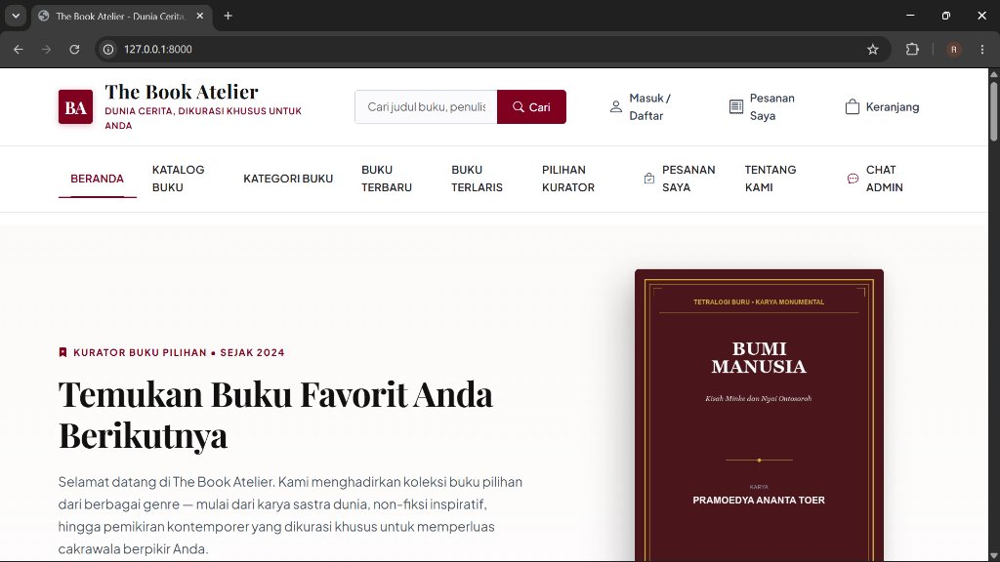

#### 2. Detail Informasi & Sinopsis Buku
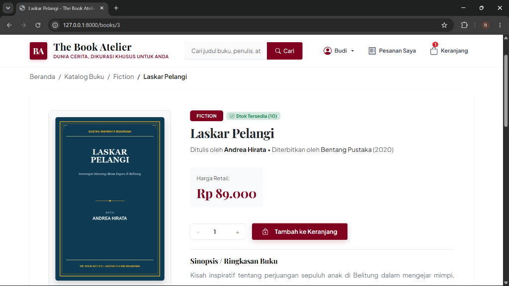

#### 3. Keranjang Belanja & Stepper Kuantitas
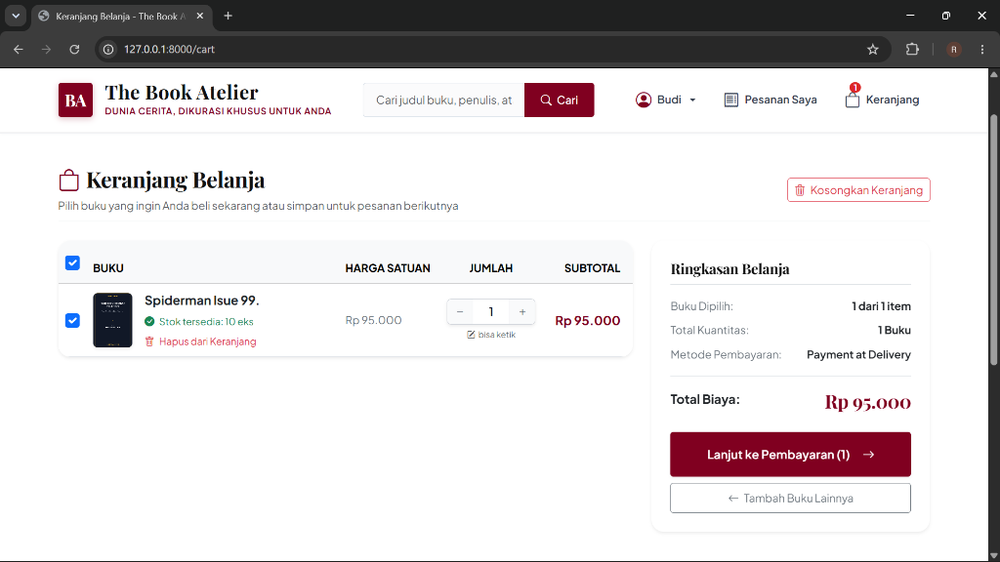

#### 4. Riwayat Pesanan Pelanggan (Pesanan Saya)
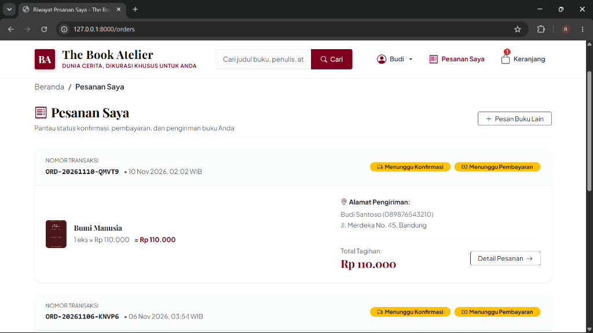

#### 5. Layanan Chat & Pesan Pelanggan (Concierge)
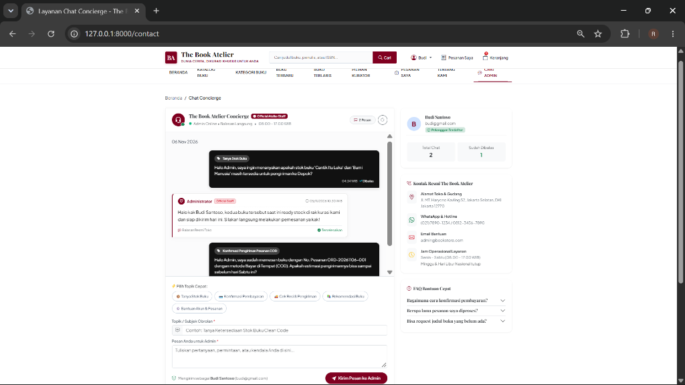

#### 6. Halaman Profil Toko (Tentang Kami)
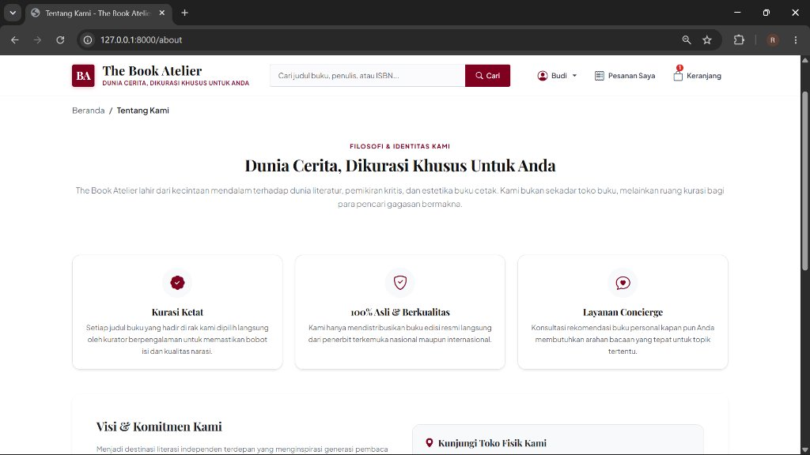

#### 7. Halaman Masuk ke Akun (Login)
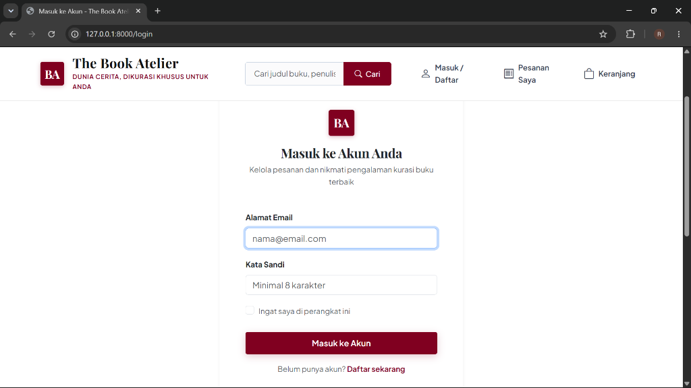

#### 8. Formulir Pendaftaran Akun Baru (Register)
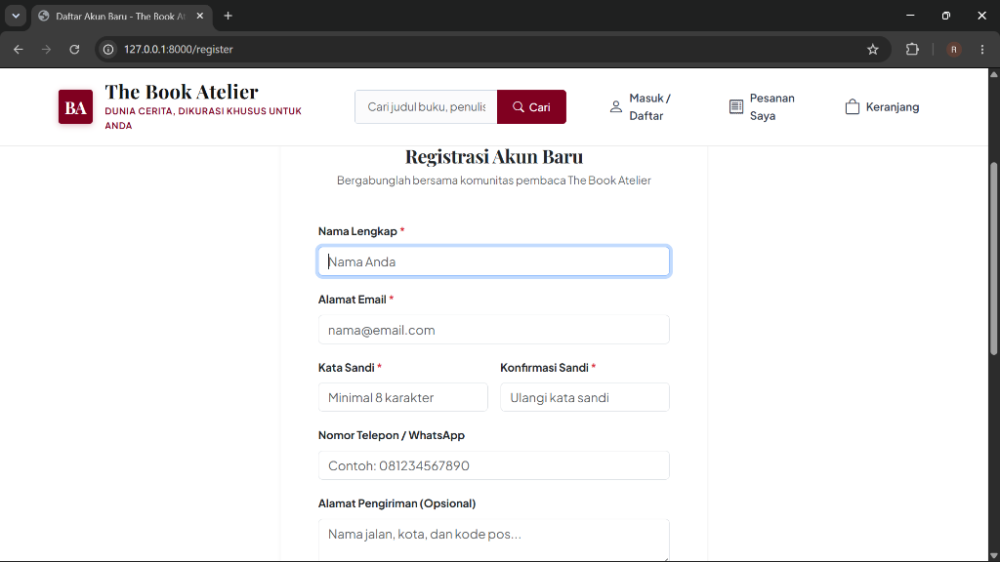

---

### ⚙️ 2. Panel Manajemen Administrator (Admin Panel)

#### 9. Dasbor Administrator & Ringkasan Statistik
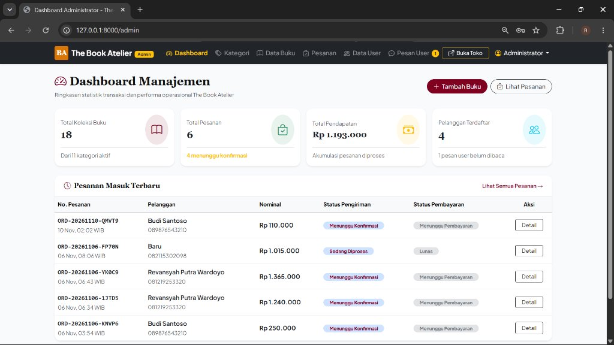

#### 10. Kelola Data Buku & Smart Restock
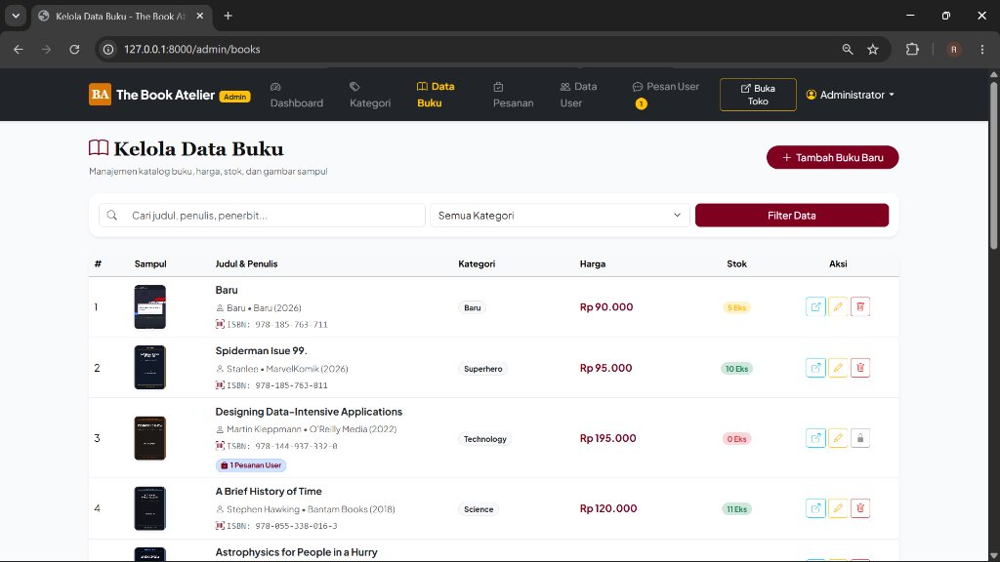

#### 11. Kelola Kategori Klasifikasi Buku
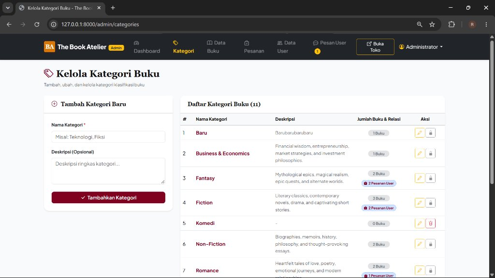

#### 12. Manajemen & Pembaruan Status Pesanan
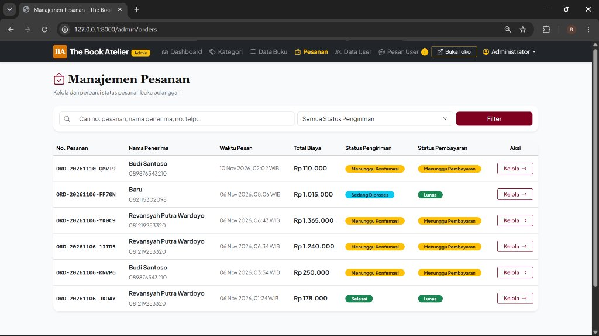

#### 13. Data Pengguna Terdaftar
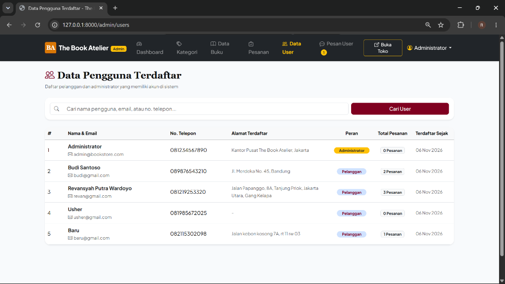

#### 14. Kelola & Balas Pesan Pengguna
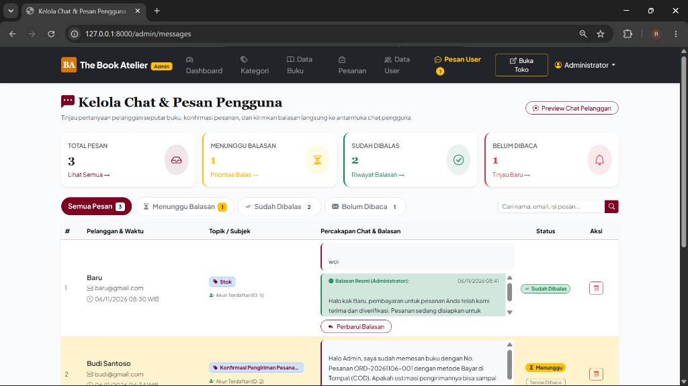

---

## 🚀 Fitur & Arsitektur Sistem

1. **Arsitektur MVC (Model-View-Controller)**:
   - **Models & Relasi Eloquent:** `User`, `Category`, `Book`, `Order`, `OrderItem`, `Message`, `CartItem`.
   - **Controllers Terstruktur:** Pemisahan controller publik (`HomeController`, `BookController`, `CartController`, `OrderController`, dll) dan panel admin (`Admin\BookController`, `Admin\CategoryController`, dll).
   - **Blade Templates:** Komponen modular dengan layout terpadu (`layouts/app.blade.php` dan `layouts/admin.blade.php`).

2. **Integritas & Proteksi Data Transaksi**:
   - Buku dan Kategori yang terhubung dengan riwayat pesanan user **tidak dapat dihapus** (`ON DELETE RESTRICT` pada basis data dan proteksi keamanan di controller).
   - Indikator status pesanan terpadu yang otomatis menyinkronkan status pembayaran menjadi lunas.

3. **Sistem Keranjang & Checkout Transaksional**:
   - Validasi stok sebelum checkout menggunakan *pessimistic locking* (`lockForUpdate`).
   - Kontrol transaksi database aman (`DB::transaction`) untuk memastikan pemotongan stok dan pembuatan nomor pesanan `ORD-YYYYMMDD-XXXXX` berjalan atomik (*all-or-nothing*).
   - Fitur seleksi checkout (ceklis item) dan penyesuaian kuantitas.

4. **Autentikasi & Otorisasi Berbasis Peran (RBAC)**:
   - Sistem login aman dengan hashing kata sandi bawaan Laravel BCRYPT (`Hash::make`).
   - Route Middleware: `auth` untuk transaksi pelanggan dan `admin` untuk panel manajemen.
   - Proteksi respon **HTTP 401 Unauthorized** (jika belum login) dan **HTTP 403 Forbidden** (jika peran tidak berhak), dengan halaman error kustom yang bersih (*minimalist*).

5. **Layanan Chat Dua Arah**:
   - Pengguna dapat mengirimkan pesan ke pengelola toko via obrolan berbalas.
   - Admin dapat membalas pesan secara real-time dan riwayat balasan langsung muncul di akun pengguna.

---

## 🔑 Akun Demo Pengujian

| Peran (Role) | Alamat Email | Kata Sandi | Halaman Akses |
| :--- | :--- | :--- | :--- |
| **Admin** | `admin@bookstore.com` | `admin123` | `/admin` |
| **User (Pelanggan)** | `budi@gmail.com` | `user1234` | `/` |

---

## 🌐 Cara Menjalankan di Laragon

1. Pastikan Laragon berjalan (**Start All** Apache & MySQL).
2. Database MySQL: `bookstore_laravel_db` (sudah ter-migrasi dan ter-seeding secara otomatis).
3. Akses via Browser:
   - 👉 **`http://bookstore-laravel.test`**  
   - Atau via localhost:  
     👉 **`http://localhost/bookstore-laravel/public`**  
   - Panel Admin:  
     👉 **`http://localhost/bookstore-laravel/public/admin`**
